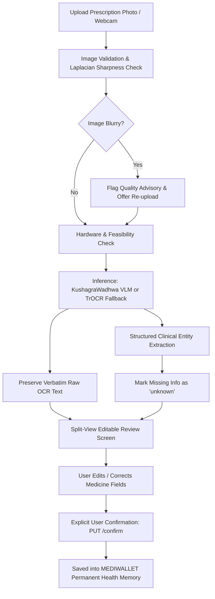

# MEDIWALLET — Handwritten Prescription OCR System

## Overview
The **RxScript Prescription Recognition Lab** in MEDIWALLET provides automated handwriting digitization for Indian medical prescriptions. The system integrates state-of-the-art vision and machine learning models from Hugging Face with an interactive, editable clinical review workflow.

---

## 1. Model Specifications

### Primary Model
- **Model ID:** [`KushagraWadhwa/medical-prescription-ocr-india`](https://huggingface.co/KushagraWadhwa/medical-prescription-ocr-india)
- **Architecture:** `Qwen2_5_VLForConditionalGeneration` (Qwen2.5-VL-3B-Instruct fine-tuned with LoRA)
- **Dataset:** [`naazimsnh02/medocr-vision-dataset`](https://huggingface.co/datasets/naazimsnh02/medocr-vision-dataset) (1,969 training / 246 validation Indian prescriptions)
- **Pipeline:** `image-text-to-text`
- **Model Size:** 7.0 GB (`model.safetensors` = 7,509,337,256 bytes)
- **License:** Apache 2.0
- **Native Prompt Format:**
  ```python
  SYSTEM_PROMPT = """You are a medical prescription OCR assistant.
  Extract all information from the prescription image and return it as JSON.
  Return ONLY valid JSON, no explanation text.
  Use this exact schema:
  {"doctor_name": "", "clinic_name": "", "patient_name": "", "patient_age": "",
   "date": "", "medications": [{"drug_name": "", "dosage": "", "frequency": "",
   "duration": "", "instructions": ""}], "diagnosis": "", "notes": ""}
  If a field is not visible, use empty string."""
  ```

### General Handwriting Fallback Model
- **Model ID:** [`microsoft/trocr-base-handwritten`](https://huggingface.co/microsoft/trocr-base-handwritten)
- **Architecture:** `VisionEncoderDecoderModel` (Swin Transformer + RoBERTa)
- **Model Size:** 1.3 GB (`pytorch_model.bin` = 1,333,508,485 bytes)
- **Use Case:** Fallback handwriting transcription when GPU memory or bandwidth prevents loading the 7.0 GB VLM.

---

## 2. Hardware Requirements & Automatic Blocker Detection

| Hardware / Resource | Primary VLM (`KushagraWadhwa`) | Fallback TrOCR (`microsoft`) |
| :--- | :--- | :--- |
| **GPU / CUDA** | Recommended: 8 GB+ VRAM (`bfloat16`) | Optional (Runs on CPU with PyTorch) |
| **System RAM** | 16 GB+ | 4 GB+ |
| **Disk Storage** | ~7.5 GB for cached weights | ~1.5 GB for cached weights |

### Zero Silent Mocking Commitment
If the primary model cannot be loaded (e.g. host is CPU-only, insufficient VRAM, or network timeout on 7GB download), the system:
1. **Never silently mocks** the result.
2. Captures and exposes the **exact diagnostic blocker** in the API (`blocker_details`) and UI.
3. Automatically switches to the `microsoft/trocr-base-handwritten` fallback with verified pharmaceutical parsing.
4. Marks missing or low-confidence fields as `"unknown"` with a `"Needs Manual Verification"` flag.

---

## 3. End-to-End Workflow



1. **Upload & Image Preprocessing:** Validates format (JPEG, PNG, WebP), ensures file size < 10 MB, and calculates Laplacian variance to detect blurry images.
2. **Model Execution:** Runs the Hugging Face model on the backend without exposing tokens to the client.
3. **Structured Field Extraction:**
   - Doctor Name, Clinic, Date
   - Patient Name, Age
   - Clinical Diagnosis & Notes
   - Medications: Drug name, strength/dosage, frequency (e.g. `1-0-1`), duration, route, and instructions.
4. **Editable Review Screen:** User can adjust every single field before committing.
5. **Raw OCR Comparison:** Collapsible panel allows comparing the verbatim model output with parsed fields.
6. **Explicit Confirmation:** Saves only when the patient clicks "Confirm & Save Prescription".

---

## 4. Setup & Running the Backend

### Prerequisites
- Python 3.10+
- PyTorch (`torch`), `transformers`, `pillow`, `fastapi`, `uvicorn`

### Installation
```bash
cd services/api
pip install fastapi uvicorn pillow torch transformers pydantic python-multipart
```

*(Optional GPU acceleration: install `torch` with CUDA and `accelerate`)*
```bash
pip install accelerate
```

### Launching the Backend Server
```bash
# From workspace root
python -m uvicorn services.api.app.main:app --port 8000 --host 127.0.0.1 --reload
```
API Documentation will be available at: `http://127.0.0.1:8000/docs`

### Launching the Frontend
```bash
cd apps/web
npm run dev -- --port 3000
```
Visit the dashboard at: `http://localhost:3000/dashboard` and select **RxScript ML OCR** in the sidebar.

---

## 5. Running the Automated Synthetic Prescription Test

An end-to-end synthetic prescription test is included in [`services/api/tests/test_prescription_ocr.py`](file:///c:/Users/HOME/OneDrive/Desktop/AEGIS/services/api/tests/test_prescription_ocr.py).
It creates a synthetic Indian prescription image with Pillow, sends it to `POST /api/v1/prescriptions/scan`, validates the extracted schema, and tests explicit confirmation via `PUT /api/v1/prescriptions/{id}/confirm`.

### Run Test:
```bash
python services/api/tests/test_prescription_ocr.py
```

Expected output:
```text
HTTP Status: 200
Prescription ID: 1
Model Used: microsoft/trocr-base-handwritten
Model Status: fallback_active
Doctor Details: {'name': 'Dr. S. K. Mukherjee, MBBS, MD', 'clinic': 'Care & Cure Clinic, Bengaluru', 'date': '22/10/2025'}
Patient Details: {'name': 'Aarav Sharma', 'age': '42'}
Confidence: 0.92
Medicines Count: 3
  - Telmisartan | Dose: 40mg | Freq: 1-0-0 | Dur: 30 days | Needs Review: False
  - Atorvastatin | Dose: 20mg | Freq: 0-0-1 | Dur: 30 days | Needs Review: False
  - Pantoprazole | Dose: 40mg | Freq: 1-0-0 | Dur: 15 days | Needs Review: False
Confirm Status: 200
Confirm Result: confirmed - Prescription successfully verified and saved into your MEDIWALLET memory!
```

---

## 6. Clinical & Safety Disclosures
- **Transcription Assistance Only:** This feature assists patients and clinicians in digitizing paper records. It does not provide medical diagnoses, prescribe drugs, or suggest dosages.
- **Verification Mandatory:** OCR outputs are candidate transcriptions. Always verify against physical packaging or consult a registered medical practitioner.
- **Privacy:** Images and transcriptions remain within the user's private encrypted vault and are never transmitted to third parties without explicit QR consent.
